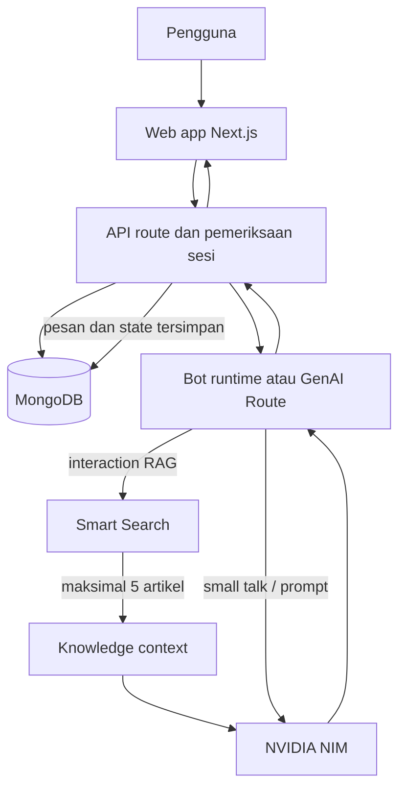

# GenAI Chatbot & AI Agent Platform

Aplikasi web untuk mengelola chatbot berbasis AI. Admin dapat menyusun alur percakapan, mengelola Knowledge Base, mengatur prompt dan provider AI, serta melihat riwayat percakapan. Sistem menggabungkan alur yang deterministik dengan generasi jawaban oleh Large Language Model (LLM).

README ini juga merangkum konsep dan alur sistem sebagai bahan penjelasan proyek.

## Ringkasan Proyek

Chatbot generatif dapat memberi jawaban yang lancar, tetapi jawaban dapat tidak sesuai dengan informasi yang dimiliki organisasi. Di sisi lain, alur percakapan statis sulit menangani pertanyaan bebas. Proyek ini menggabungkan kedua pendekatan: alur yang dirancang pengelola untuk menjaga proses tetap terarah, serta AI generatif untuk menangani percakapan dan menyusun jawaban.

**Tujuan:** menyediakan dashboard agar pengelola dapat membuat chatbot, mengisi sumber pengetahuan, memilih alur dan prompt, lalu menguji percakapan tanpa perlu mengubah kode untuk setiap bot.

**Pengguna:** admin mengelola seluruh sistem; manager mengelola fitur operasional yang diizinkan; public user menggunakan chatbot dan melihat percakapannya sendiri.

## Fitur

- Autentikasi, pengelolaan pengguna, dan kontrol akses berbasis peran.
- Chatbot builder dengan interaction seperti welcome message, guided routing, tanya-jawab, small talk, RAG, web search, dan data collection.
- Data collection bertahap yang menyimpan jawaban sebagai state percakapan dan dapat digunakan oleh langkah berikutnya.
- Knowledge Base terpisah, input artikel manual, dan impor CSV.
- Smart Search yang memberi skor relevansi artikel dan mengambil maksimal lima artikel teratas sebagai konteks AI.
- Pengelolaan prompt, flow dialog, skill, dan reusable component.
- Riwayat percakapan dan informasi sumber artikel yang cocok.
- Engagement widget iframe untuk menyematkan skill bot aktif pada website dengan entry point/origin yang diizinkan.
- Provider AI NVIDIA NIM; admin dapat mengelola API key dan model dari dashboard.

## Konsep AI

### Smart Search dan RAG

Untuk interaction RAG, sistem menjalankan pencarian sebelum meminta model menghasilkan jawaban:

1. Query dinormalisasi menjadi huruf kecil dan tanda baca dibersihkan.
2. Query dipecah menjadi token dan kata umum (stop words) disaring.
3. Token dicocokkan dengan judul, tag, kategori, ringkasan, detail, konten, serta field teks tambahan pada artikel.
4. Sistem memberi bobot pada kecocokan, mengurutkan artikel berdasarkan skor, lalu memilih maksimal lima artikel.
5. Artikel terpilih disusun menjadi knowledge context dan dikirim bersama pertanyaan ke LLM.
6. Jawaban, skor, dan artikel terkait disimpan atau ditampilkan dalam percakapan.

Ini merupakan pola **Retrieval-Augmented Generation (RAG)**: informasi diambil dari Knowledge Base terlebih dahulu, kemudian digunakan model sebagai konteks. Retrieval dalam implementasi ini adalah pencarian leksikal dengan scoring berbobot, **bukan** embedding atau vector database. Karena itu, hasil pencarian bergantung pada kemiripan kata dan kualitas artikel.

### Generasi dan routing

- **Flow bot:** runtime mengikuti interaction dan transisi yang disusun pengelola. Guided Routing, Small Talk, RAG, Web Search, dan AI Data Collection menggunakan provider/model NVIDIA NIM yang dikonfigurasi untuk flow. Interaction lain memberi respons tetap, mengumpulkan data, memanggil API, atau mengalihkan percakapan.
- **GenAI Route:** pada mode chat tanpa flow bot, prompt route mengklasifikasikan pesan menjadi `SMALL_TALK` atau `FAQ`. Kategori tersebut menentukan prompt dan langkah respons berikutnya.
- **LLM:** proyek tidak melatih model sendiri. Aplikasi mengirim permintaan ke NVIDIA NIM dan menerima teks jawaban. API key dapat disimpan terenkripsi melalui menu Providers atau dibaca dari environment server; key tidak dikirim sebagai bagian dari payload model.

## Arsitektur dan Alur Data



Next.js menangani antarmuka dan API. API memvalidasi sesi pengguna, membaca atau memperbarui data di MongoDB, menjalankan flow dan pencarian, lalu memanggil provider AI bila interaction membutuhkannya. Riwayat pesan, state flow, dan jawaban data collection dapat disimpan pada dokumen conversation.

## Teknologi

| Bagian | Teknologi |
|---|---|
| Web dan API | Next.js 16, React 19, TypeScript |
| Styling | Tailwind CSS 4 |
| Database | MongoDB dan MongoDB Node.js Driver |
| Autentikasi | JWT dengan cookie HttpOnly; bcrypt untuk password |
| Chat completion | NVIDIA NIM |
| Import CSV | Papa Parse |
| Visual flow | React Flow (`@xyflow/react`) |
| Hosting | Vercel (opsional) |

## Struktur Data

Database yang digunakan aplikasi bernama `aiChatbot`. MongoDB bersifat fleksibel; collection dapat dibuat saat dokumen pertama dimasukkan.

| Collection | Kegunaan |
|---|---|
| `users` | Identitas pengguna, role, dan password hash |
| `bots` | Definisi bot, daftar interaction, posisi node, dan transisi |
| `botSettings` | Referensi bot aktif |
| `conversations` | Pemilik percakapan, pesan, message count, dan state bot |
| `knowledgeBases` | Metadata Knowledge Base dan nama collection artikelnya |
| `kb_<slug>` | Artikel untuk masing-masing Knowledge Base; nama dibuat dinamis |
| `prompts` | Template prompt berdasarkan jenisnya |
| `aiProviderConnections` | Koneksi provider, model terpilih, dan kredensial provider terenkripsi |
| `skills` | Skill yang menghubungkan user bot dengan bot flow |
| `engagements` | Konfigurasi widget website, allowlist entry point, dan chat windows yang terhubung ke skill bot |
| `components` | Template tombol, kartu, carousel, dan referensi artikel |
| `flowDialogs` | Flow dialog yang disimpan sebagai nodes dan edges |
| `knowledgeBase` | Collection artikel lama untuk kompatibilitas endpoint terdahulu |

Dokumen memakai `_id` ObjectId bawaan MongoDB serta timestamp seperti `createdAt` dan `updatedAt`. Collection Knowledge Base dinamis memungkinkan tiap basis pengetahuan dipisahkan dari basis lainnya.

## Keamanan dan Batasan

- Endpoint terlindungi memeriksa sesi dan role pengguna.
- Password pengguna di-hash sebelum disimpan. Token sesi disimpan dalam cookie HttpOnly.
- Widget Engagement hanya dapat dimuat dari origin yang terdaftar. API publik menggunakan token widget bertanda tangan dan token acak terpisah untuk membatasi setiap percakapan visitor.
- Daftarkan origin lengkap (misalnya `https://contoh.com`) dan pasang snippet iframe yang dihasilkan dashboard pada origin tersebut. Pastikan browser mengirim referrer origin agar validasi entry point dapat berjalan.
- `MONGODB_URI`, `JWT_SECRET`, `NVIDIA_API_KEY`, dan `PROVIDER_CREDENTIALS_ENCRYPTION_KEY` adalah konfigurasi server yang sensitif. Jangan commit `.env.local` atau menuliskan nilai rahasia ke README. NVIDIA API key juga dapat dikelola dari menu Providers.
- `PROVIDER_CREDENTIALS_ENCRYPTION_KEY` wajib diisi (minimal 32 karakter) sebelum menyimpan API key provider dari dashboard.
- Smart Search berbasis kata, bukan pemahaman semantik. Pertanyaan dengan istilah berbeda dari artikel dapat memperoleh skor rendah.
- Kualitas jawaban RAG dibatasi oleh kualitas dan cakupan Knowledge Base serta model/provider yang digunakan.
- Provider AI eksternal dapat memiliki batas pemakaian, latensi, atau perubahan ketersediaan model.

## Menjalankan Secara Lokal

Prasyarat: Node.js, npm, dan MongoDB yang dapat dijangkau dari komputer.

1. Install dependency:

	```bash
	npm ci
	```

2. Buat `.env.local` di root proyek. Isi dengan nilai milikmu sendiri; jangan gunakan placeholder sebagai kredensial nyata:

	```dotenv
	MONGODB_URI=mongodb://localhost:27017/aiChatbot
	JWT_SECRET=<random-secret-strong>
	PROVIDER_CREDENTIALS_ENCRYPTION_KEY=<random-secret-minimal-32-karakter>
	NVIDIA_API_KEY=<opsional-jika-menggunakan-key-dari-environment>
	```

	Untuk MongoDB Atlas, ganti `MONGODB_URI` dengan connection string Atlas. API key NVIDIA boleh dimasukkan melalui menu Providers; `NVIDIA_API_KEY` (atau `NVCF_API_KEY`) dapat dipakai sebagai key dari environment. Buat nilai encryption key yang acak dan rahasiakan.

3. Jalankan aplikasi:

	```bash
	npm run dev
	```

	Jika PowerShell memblokir `npm.ps1`, jalankan `npm.cmd run dev`.

	Buka `http://localhost:3000`.

Perintah lain:

```bash
npm run build
npm run start
npm run lint
```

## Panduan Admin

Panduan ini menjelaskan menu yang tersedia bagi role **admin**. Admin dapat mengelola konfigurasi dan data operasional. Sebagian menu operasional juga tersedia bagi manager; **Users** khusus admin. Role dan tipe user berbeda: role menentukan hak akses, sedangkan tipe `Human` atau `Bot` digunakan untuk menghubungkan skill.

### Menu admin

| Menu | Fungsi dan alur utama |
|---|---|
| **Dashboard** | Ringkasan jumlah user, koleksi dan artikel Knowledge Base, percakapan, serta prompt. Gunakan tautan cepat untuk masuk ke pengelolaan KB, Chatbot, Providers, dan riwayat. |
| **Users** | Khusus admin. Cari/filter user, tambah, edit, atau hapus akun. Atur username, nama lengkap, email, password awal, role (`admin`, `manager`, `public_user`), dan tipe user (`Human` atau `Bot`). Password di-hash sebelum disimpan. Buat user bertipe Bot untuk identitas skill bot; operator human yang menangani eskalasi harus dapat mengakses dashboard, biasanya role manager atau admin. |
| **Chatbot** | Ruang uji percakapan. Pilih skill bila tersedia, buat percakapan, kirim pesan, lalu periksa hasil flow dan respons. Riwayat pribadi dapat dibuka kembali, pesan dapat disalin, dan pesan user dapat diedit lalu dikirim ulang. |
| **Setting** | Atur style global komponen chat dan preview-nya. **Simpan global** menyimpan default; **Apply ke semua Engagement** menyalin style tersebut ke semua chat window dan menimpa style khusus window. Bagian animasi bubble mengatur efek global saat pesan masuk ke tampilan Chatbot. |
| **Bot Management** | Buat, duplikasi, aktif/nonaktifkan, ubah nama, hapus bot, lalu susun flow visual. Panduan rinci ada di bagian berikutnya. |
| **Skills** | Hubungkan identitas user (Human atau Bot) ke penggunaan bot. Skill bot dapat dipasangkan dengan bot flow aktif; skill Human menjadi penerima eskalasi. Atur nama, deskripsi, pesan pengantar, duplikasi, dan status relasi. |
| **Engagement** | Buat widget website, daftarkan origin yang diizinkan, hubungkan chat window ke skill bot aktif, atur tampilan, lalu salin kode iframe. Detail ada di bagian Engagement. |
| **Providers** | Hubungkan NVIDIA NIM, simpan API key dengan aman, uji koneksi, muat daftar model, dan pilih model yang boleh dipakai flow. Hanya model terpilih yang muncul di Bot Management. |
| **Chat History** | Riwayat percakapan milik akun yang sedang login. Pilih percakapan untuk melihat pesan dan metadata, atau lanjutkan chat. |
| **Escalation Queue** | Tangani percakapan yang dialihkan ke skill Human: terima, baca dan balas, transfer ke skill lain, atau tutup percakapan. Queue diperbarui otomatis. |
| **All Conversations** | Pantau percakapan seluruh sistem. Cari user/judul, filter bot, skill, dan rentang tanggal, buka detail dan profil terkait, atau hapus percakapan. |
| **Knowledge Base** | Buat dan aktif/nonaktifkan koleksi KB, kelola artikel manual atau lewat CSV, cari/filter, edit, hapus, serta ekspor artikel. |
| **Data Bot Data Collection Capture** | Lihat record yang dikirim node Data Collection Submitted, per bot dan per halaman. Ekspor halaman yang sedang ditampilkan ke CSV atau hapus record. |
| **Components** | Buat template pesan reusable berupa Reply Buttons, Link Buttons, Card, atau Carousel. Kelola artikel terkait, aktif/nonaktifkan, duplikasi, serta impor/ekspor JSON. |
| **Prompts** | Buat dan kelola prompt bertipe FAQ, Route, Small Talk, Guided Routing, atau RAG. Aktifkan prompt yang akan dipilih di node terkait. |

### Urutan setup yang disarankan

1. **Siapkan environment dan database.** Pastikan MongoDB dapat dijangkau dan `JWT_SECRET` sudah diganti untuk deployment.
2. **Hubungkan AI di Providers.** Buka NVIDIA NIM, tambahkan API key, uji koneksi untuk memuat model, lalu pindahkan model yang akan dipakai ke daftar model digunakan. Jika key disimpan dari dashboard, atur `PROVIDER_CREDENTIALS_ENCRYPTION_KEY` di environment server terlebih dahulu.
3. **Siapkan data dan template.** Buat Knowledge Base lalu isi artikel; siapkan prompt dan Components bila flow membutuhkannya.
4. **Buat bot dan flow.** Susun interaction, pilih Entry interaction, hubungkan node, isi konfigurasi, lalu simpan flow.
5. **Buat user dan skill.** Buat user bertipe Bot dan pasangkan ke bot flow aktif melalui Skills. Untuk eskalasi, siapkan user Human ber-role manager/admin, lalu buat skill Human.
6. **Uji di Chatbot.** Pilih skill bot, coba semua jalur, variabel, pencarian, pengumpulan data, dan respons. Periksa hasil di Chat History, All Conversations, dan halaman capture.
7. **Atur tampilan dan Engagement.** Sesuaikan style global, buat Engagement dan chat window, uji pada origin website yang terdaftar, lalu salin dan pasang iframe.
8. **Operasikan.** Pantau All Conversations; tangani eskalasi di Escalation Queue; ekspor data capture bila diperlukan.

### Bot Management: menyusun flow

#### Membuat bot dan mengatur canvas

1. Buka **Bot Management → Buat bot**, isi nama dan deskripsi. Bot baru memiliki flow awal dengan Welcome Message dan Text Interaction.
2. Buka bot untuk masuk ke editor. Panel **Interactions** berisi node yang dapat diklik atau diseret ke canvas.
3. Klik node untuk membuka **Properti interaction**. Atur nama, variabel lokal, dan detail node. Pilih **Entry interaction** untuk menentukan node pertama saat percakapan dimulai.
4. Hubungkan handle node pada canvas untuk mengatur urutan. Untuk Guided Routing, tentukan target pada setiap route dan fallback-nya.
5. Node selain Guided Routing dapat mengakhiri interaction, menutup percakapan, atau berlanjut ke interaction berikutnya. Posisi node dan perubahan flow baru tersimpan setelah **Simpan flow**.
6. Aktifkan bot. Skill bot hanya dapat dipasangkan ke bot aktif. Status aktif bot tidak menggantikan pemilihan skill pada Chatbot atau Engagement.

#### Jenis interaction

| Interaction | Yang dikonfigurasi |
|---|---|
| **Welcome Message** | Judul, subtitle, ikon (bot atau URL HTTPS publik), footer, dan tombol cepat reply/link. |
| **Text Interaction** | Pesan tetap; dapat menggunakan variabel bot seperti `{question}`, `{fullName}`, atau variabel yang tersedia di editor. |
| **Text Question Interaction** | Pertanyaan/tampilan teks dan tombol reply atau link. |
| **Guided Routing** | Pesan pemilihan topik, satu atau lebih route (label, variabel, instruksi route, dan target interaction), prompt template, provider/model, parameter LLM, serta pesan dan target fallback. Setiap route harus diarahkan ke node yang sesuai. |
| **Small Talk** | Respons basa-basi, system prompt atau prompt template, provider/model, temperature, dan batas token. |
| **RAG** | Pilih satu atau lebih Knowledge Base aktif, jumlah dokumen retrieval (1–10), prompt, provider/model, temperature, dan batas token. Retrieval memakai Smart Search berbobot kata; pastikan artikel relevan sudah tersedia. |
| **Web Search** | Jumlah sumber web, instruksi/prompt, provider/model, dan parameter generasi. Jawaban menggunakan cuplikan sumber web dan sitasi. |
| **AI Data Collection** | Aturan umum AI serta daftar pertanyaan berupa nama field, prompt pertanyaan, contoh, dan variabel jawaban. Tambahkan komponen balasan bila diperlukan. |
| **Data Collection** | Daftar pertanyaan tetap; atur teks pertanyaan, nama dan variabel jawaban. Pertanyaan dapat menampilkan reply/link buttons, card, atau carousel dan validator akhir. |
| **Data Collection Submitted** | Daftarkan pasangan nama field dan variabel yang harus disimpan. Letakkan setelah pengumpulan data agar nilai percakapan ditulis sebagai record bot. Record muncul di menu Data Bot Data Collection Capture. |
| **Skill Escalation** | Pilih skill Human yang tersedia dan atur pesan pengalihan. Percakapan masuk ke Escalation Queue sebagai pending sampai diterima operator. |
| **API Integration** | Atur URL HTTPS publik, metode HTTP, query/header, autentikasi, body, timeout, pemetaan response ke variabel, pesan hasil, dan jalur sukses/gagal. Custom JS opsional dapat memproses response setelah HTTP selesai. Uji endpoint dan validasi data sebelum mengaktifkannya. |

#### Provider, prompt, dan variabel

- Provider/model dipilih pada node LLM. Konfigurasi provider dan model dibagikan oleh Guided Routing, Small Talk, RAG, Web Search, dan AI Data Collection dalam flow tersebut.
- Prompt template dapat dipilih dari menu Prompts atau diedit langsung dari properti node. Variabel sistem ditampilkan pada tombol bantuan dan daftar variabel di editor; pertanyaan Data Collection menambahkan variabel jawabannya.
- Variabel lokal memiliki nilai statis. Nama variabel manual harus unik dan tidak boleh bentrok dengan nama bawaan. Tulis variabel di prompt/message dengan kurung kurawal, misalnya `{nama_lengkap}`.

### Knowledge Base, Prompts, dan Components

- **Knowledge Base:** pilih **Add Collection**, isi nama dan deskripsi, lalu buka koleksi untuk menambah artikel. Artikel manual memiliki judul, kategori, tags, ringkasan, dan konten/detail. Untuk CSV, pilih koleksi terlebih dahulu, unggah file dengan header kolom, periksa preview, lalu impor. Aktifkan koleksi yang akan dipilih oleh node RAG; nonaktifkan untuk mengeluarkannya dari pilihan RAG.
- **Prompts:** pilih tipe, isi nama dan konten, lalu simpan. Gunakan variabel yang sesuai dengan interaction, contohnya `{question}`, `{message}`, atau `{context}`. Filter berdasarkan tipe; aktifkan/nonaktifkan, duplikasi, edit, atau hapus prompt.
- **Components:** buat template dengan nama dan tipe. Isi label, aksi dan nilai tombol; Card dapat berisi gambar, judul, subtitle dan tombol; Carousel dapat memiliki beberapa card. Tambahkan referensi artikel bila relevan. Impor menerima 1–100 komponen JSON; format yang paling mudah disiapkan adalah hasil ekspor halaman Components.
- **Data Collection Capture:** pilih bot pada panel kiri, telusuri halaman record, lalu ekspor CSV untuk halaman yang tampil. Penghapusan record atau hapus semua bersifat permanen.

### Skills dan akun user

- Buat user bot di **Users** dengan tipe `Bot`, kemudian buat bot dan aktifkan flow-nya. Di **Skills**, buat skill, pilih user Bot, aktifkan pilihan untuk memasangkan bot flow, dan pilih bot aktif tersebut.
- Buat akun operator dengan tipe `Human` dan role yang memiliki akses operasional (manager/admin). Buat skill Human tanpa memasangkan bot flow; skill inilah yang dapat dipilih pada Skill Escalation.
- Intro message skill dapat diaktif/nonaktifkan dan diedit. Status “Siap digunakan” pada daftar skill menandakan relasi user/bot masih tersedia.
- Menu Users dapat mencari dan memfilter role. Saat mengedit password, kosongkan field password jika tidak ingin menggantinya.

### Engagement: konfigurasi dan pemasangan widget

1. Di **Engagement**, buat konfigurasi baru dengan nama yang mudah dikenali, misalnya “Website utama”, lalu buka **Kelola**.
2. Pada tab **Umum**, atur nama dan aktifkan Engagement. Daftarkan website sebagai origin lengkap (misalnya `https://contoh.com`), bukan path halaman. Origin harus sama dengan website tempat iframe dipasang; hingga 20 origin dapat didaftarkan.
3. Pada tab **Chat windows**, tambah window dan pilih **skill bot yang tersedia dan terhubung ke bot aktif**. Isi nama internal, judul/subjudul dan URL ikon opsional. Atur tombol close, posisi sudut dan jarak X/Y, animasi window, animasi bubble, serta style komponen. Preview membantu memeriksa tampilan. Warna dan CSS komponen dapat diatur di sini atau melalui style global di **Setting**.
4. Tekan **Simpan perubahan** sebelum membuat kode embed. Perubahan tab yang belum disimpan tidak otomatis diterapkan.
5. Pada tab **Embed**, pilih entry point dan chat window, salin snippet iframe, lalu tempelkan di HTML website pada origin yang terdaftar. Coba widget langsung di website target. Snippet berisi `referrerpolicy` agar pemeriksaan origin dapat berjalan.

Setiap window menjalankan skill dan flow bot yang dipilih. Percakapan visitor tersimpan sebagai Engagement di `conversations`. Minimalkan widget menyembunyikan window tanpa mengakhiri sesi; menutup percakapan mengakhiri sesi. Jika widget tidak muncul, periksa status aktif Engagement, origin/HTTPS, skill dan bot aktif, lalu pastikan snippet dipasang pada domain yang terdaftar.

### Pengaturan tampilan dan operasional

- **Setting → Style global chatbot:** atur CSS/style setiap komponen dan lihat preview. Simpan global untuk memperbarui style default. Tombol apply ke semua Engagement menimpa style khusus pada seluruh chat window setelah konfirmasi; gunakan hanya bila memang ingin menyeragamkan tampilannya.
- **Setting → Animasi bubble saat scroll:** aktifkan/nonaktifkan dan pilih Fade, Slide, Pop, Naik, atau Blur. Preferensi ini dibagikan dan berlaku untuk seluruh pengguna.
- **Chatbot:** gunakan untuk uji fungsional sebelum integrasi; pastikan skill dan bot yang diuji benar.
- **All Conversations:** gunakan filter untuk menemukan percakapan tertentu dan membuka detail user, bot, serta skill. Tombol **Hapus semua percakapan** menghapus seluruh percakapan sistem, termasuk yang tidak tampak karena filter; tindakan ini permanen.
- **Escalation Queue:** percakapan pending harus diterima sebelum riwayat dan balasan dibuka. Setelah accept, balas user, transfer ke skill tujuan, atau tutup percakapan.

`npm run seed` menambahkan data contoh untuk pengembangan/demo. Tinjau `scripts/seed.mjs` sebelum menjalankannya dan jangan gunakan akun atau data seed sebagai konfigurasi produksi.

## Deployment ke Vercel

1. Import repository GitHub sebagai project Next.js. Root Directory harus menunjuk ke folder yang berisi `package.json`.
2. Tambahkan environment variables di Vercel: `MONGODB_URI`, `JWT_SECRET`, dan `PROVIDER_CREDENTIALS_ENCRYPTION_KEY`. Tambahkan `NVIDIA_API_KEY` bila ingin menggunakan API key dari environment, bukan menyimpan key melalui dashboard.
3. Gunakan MongoDB Atlas atau MongoDB yang dapat dijangkau dari Vercel; jangan gunakan URI localhost.
4. Deploy, periksa build log, lalu uji login, pembuatan percakapan, Knowledge Base, serta respons AI.

## Panduan Presentasi

### Narasi singkat

> “Proyek saya adalah platform chatbot GenAI yang dapat dikonfigurasi melalui dashboard. Pengelola dapat menyusun flow percakapan dan Knowledge Base, sedangkan pengguna berinteraksi melalui chat. Untuk pertanyaan berbasis pengetahuan, sistem melakukan Smart Search, memberi skor pada artikel, dan hanya mengirim maksimal lima artikel paling relevan sebagai konteks ke model AI. Dengan cara ini, model dibantu oleh data proyek, bukan diminta menjawab dari pertanyaan saja. Sistem juga mendukung flow deterministik, pengumpulan data bertahap, riwayat percakapan, dan pilihan provider AI. Retrieval saat ini menggunakan pencocokan kata berbobot, belum menggunakan embedding atau vector database.”

### Urutan demo yang disarankan

1. Login dan tunjukkan dashboard serta pembagian role.
2. Buka Knowledge Base dan tunjukkan artikel yang menjadi sumber jawaban.
3. Tunjukkan bot flow: interaction, koneksi antar-node, atau data collection.
4. Mulai percakapan dan ajukan pertanyaan yang jawabannya ada di artikel.
5. Jelaskan bahwa sistem memilih maksimal lima artikel, lalu model menyusun jawaban dengan konteks tersebut.
6. Tunjukkan riwayat percakapan dan, bila tersedia, artikel yang cocok.

### Pertanyaan yang mungkin ditanyakan

**Apa bagian AI dalam proyek ini?**

Model LLM menghasilkan respons dan dapat membantu routing pertanyaan. Smart Search mengambil informasi relevan dari Knowledge Base sebelum respons RAG dibuat.

**Apakah proyek melatih model sendiri?**

Tidak. Proyek mengintegrasikan model melalui NVIDIA NIM. Fokus implementasi adalah orkestrasi percakapan, retrieval, prompt, dan integrasi data.

**Mengapa konteks dibatasi lima artikel?**

Agar hanya informasi yang paling relevan dikirim sebagai konteks, mengurangi data yang tidak berkaitan, dan menjaga ukuran prompt tetap terkendali. Batasnya dapat diubah di kode.

**Apakah sudah memakai vector database atau embedding?**

Belum. Retrieval menggunakan normalisasi query, tokenisasi, stop words, pencocokan beberapa field artikel, dan scoring berbobot. Ini lebih sederhana, mudah dijelaskan, dan menjadi batasan untuk pencarian semantik.

**Bagaimana mengurangi jawaban yang mengarang?**

Pertanyaan RAG diberi konteks artikel dan instruksi untuk menjawab berdasarkan konteks. Namun, pendekatan ini tidak menjamin jawaban selalu benar; hasil tetap perlu diuji terhadap kualitas data dan perilaku model.

## Pengembangan Lanjutan

- Mengukur kualitas retrieval dengan kumpulan query dan artikel berlabel.
- Membandingkan pencarian berbobot saat ini dengan embedding/vector search.
- Menambah sitasi sumber yang konsisten dan evaluasi jawaban berbasis konteks.
- Menambah logging, pemantauan latensi, serta penanganan batas pemakaian provider.
- Memperkuat validasi input, kebijakan retensi data, dan pengelolaan secret untuk deployment.

## Referensi Implementasi

- [Smart Search](src/lib/smart-search.ts)
- [AI provider dan completion](src/lib/ai.ts)
- [Bot runtime](src/lib/bot-runtime.ts)
- [Pemrosesan pesan conversation](src/app/api/conversations/[id]/messages/route.ts)
- [MongoDB connection](src/lib/mongodb.ts)
