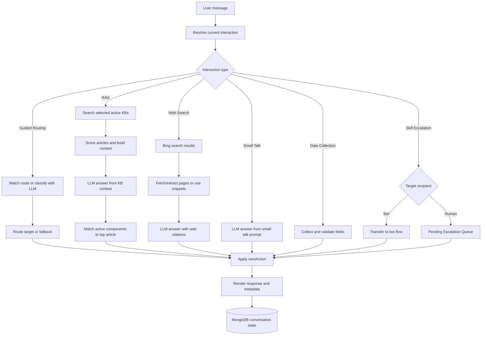

# AI Chatbot & AI Agent Platform

Dokumen ini dibuat untuk kebutuhan presentasi demo proyek. Isi README ini berfokus pada apa yang sudah ada di aplikasi, bagaimana chatbot bekerja, teknologi yang dipakai, mekanisme AI dan bot runtime, serta alur demo yang bisa ditampilkan ke audiens.

## 1. Gambaran Umum Proyek

Proyek ini adalah platform chatbot berbasis AI yang memungkinkan admin atau manager untuk:

- membuat chatbot dan alur percakapan
- mengelola Knowledge Base
- mengatur prompt dan konfigurasi AI
- memilih provider LLM
- menguji chatbot secara langsung dari dashboard
- memonitor riwayat percakapan
- membuat bot dengan flow yang terstruktur, bukan sekadar chat satu arah

Aplikasi ini bukan hanya chatbot casual. Ini adalah sistem AI agent-like dengan kombinasi:

- flow percakapan terstruktur
- routing berbasis interaction
- Knowledge Base sebagai sumber informasi
- retrieval untuk mengambil konteks yang relevan
- model LLM untuk menghasilkan jawaban natural
- reusable components seperti tombol, card, dan carousel untuk pengalaman interaksi yang lebih kaya

Jadi intinya: proyek ini menggabungkan antara chatbot biasa, RAG, workflow bot, dan dashboard manajemen.

---

## 2. Fitur yang Ada di Aplikasi

### 2.1 Autentikasi dan Manajemen Pengguna

Aplikasi memiliki sistem autentikasi dengan login/register dan role-based access:

- admin
- manager
- public_user

Fitur ini dipakai untuk membatasi akses ke dashboard, bot management, knowledge base, dan mode publik.

### 2.2 Dashboard Admin / Manager

Dashboard mengelola beberapa hal penting:

- total pengguna
- jumlah percakapan
- jumlah prompt
- jumlah sumber pengetahuan
- daftar knowledge base yang aktif
- statistik bot dan alur
- visual overview dari ekosistem sistem

### 2.3 Knowledge Base Management

Aplikasi menyediakan fitur untuk:

- membuat knowledge base baru
- menambahkan artikel secara manual
- import artikel dari CSV
- edit dan hapus artikel
- melihat detail artikel
- filter berdasarkan kategori
- mencari artikel dari KB yang aktif

Knowledge Base adalah sumber utama sebagai pengetahuan yang dibaca oleh chatbot.

### 2.4 Bot Builder / Flow Manager

Fitur utama aplikasi adalah bot builder. Di sini admin bisa membuat alur bot seperti:

- welcome message
- guided routing
- text question
- small talk
- rag
- web search
- data collection
- skill escalation

Bot dibuat dalam bentuk interaction graph, seperti node dan edge, mirip state machine. Setiap node bisa memiliki nextAction, route, prompt, variabel, dan konfigurasi khusus.

### 2.5 Prompt Management

Aplikasi juga punya manajemen prompt yang dipakai untuk:

- guided routing
- rag
- small talk

Prompt bisa diatur per interaction, sehingga setiap bot bisa punya gaya respons yang berbeda.

### 2.6 Chatbot Experience

Chatbot memungkinkan:

- percakapan langsung dengan user
- pilihan tombol quick reply
- pertanyaan bebas
- jawaban berdasarkan data internal Knowledge Base
- menampilkan komponen UI seperti tombol, card, carousel
- menampilkan sumber artikel yang relevan
- melanjutkan percakapan dengan state yang tersimpan

### 2.7 AI Provider Configuration

Proyek mendukung dua mode AI utama:

- LM Studio (local model / lokal)
- OpenRouter (cloud / API access)

Ini sangat penting karena aplikasi bisa dipakai dengan model lokal maupun model publik tanpa harus menulis custom model sendiri.

---

## 3. Chatbotnya Itu Apa Sebenarnya?

Chatbot dalam aplikasi ini bukan chatbot "asal jawab" yang berdiri sendiri tanpa konteks. Ia adalah chatbot yang dibangun dengan arsitektur hybrid:

- deterministic flow: bot mengikuti alur yang sudah ditentukan
- generative AI: model menghasilkan jawaban natural
- retrieval-based knowledge: bot mencari informasi dari Knowledge Base sebelum menjawab

Jadi chatbot ini berfungsi seperti AI assistant yang:

1. memahami intension user
2. memilih interaction yang tepat
3. mencari sumber data yang relevan
4. mengirim konteks ke LLM
5. menghasilkan jawaban berbasis data
6. menampilkan komponen interaksi tambahan bila perlu

Dengan kata lain, bot ini bukan sekadar chat model saja. Ia adalah sistem AI agent yang dibentuk dari flow + retrieval + generation + UI.

---

## 4. Teknologi yang Dipakai

| Bagian | Teknologi |
|---|---|
| Frontend | Next.js 16, React 19, TypeScript |
| Styling | Tailwind CSS 4 |
| Backend API | Next.js App Router API Routes |
| Database | MongoDB |
| Auth | JWT + cookie + bcryptjs |
| Flow Editor | React Flow / @xyflow/react |
| AI Provider | LM Studio dan OpenRouter |
| CSV Import | Papa Parse |
| UI Icons | Lucide React |

### LLM yang dipakai

Aplikasi ini tidak melatih model sendiri. Ia memanfaatkan provider AI yang sudah ada:

- LM Studio untuk model lokal
- OpenRouter untuk model cloud

Model yang dipilih bisa berupa model gratis atau model lokal yang kompatibel dengan OpenAI-like API.

Contoh model yang terdaftar di kode adalah:

- openrouter/free
- Llama 3.3 70B Instruct
- Llama 3.1 8B Instruct
- Gemini 2.0 Flash
- Gemma 3
- Phi-4
- Mistral 7B
- Qwen3
- DeepSeek R1

Secara teknis, aplikasi memanggil endpoint chat/completions yang kompatibel OpenAI, baik ke LM Studio maupun OpenRouter.

---

## 5. Cara Kerja Chatbot / Mekanisme Sistem

### 5.1 Conversation dan skill yang dipilih

Saat conversation dibuat, sistem menyimpan user pemilik, skill yang dipilih, pesan awal, dan state flow.

- Skill yang terhubung ke bot flow menjalankan entry interaction milik bot tersebut.
- Skill yang ditugaskan langsung ke user human membuat conversation berstatus `pending` dan mengarahkannya ke Escalation Queue penerima skill. Pesan perkenalan dari skill dapat ditampilkan jika diaktifkan.
- Jika tidak ada skill bot yang dipilih, aplikasi dapat memakai active bot global yang dikonfigurasi.

### 5.2 Pemilihan interaction

Pada setiap pesan, runtime membaca `currentInteractionId` conversation. Jika belum ada state aktif atau flow sebelumnya selesai, runtime memulai dari entry interaction bot. Handler interaction ditentukan oleh tipe node yang sedang aktif; tidak semua pesan melewati RAG.

`nextAction` menentukan node berikutnya, mengakhiri flow, atau menutup conversation. Guided Routing dapat memilih target node berdasarkan route yang dibuat di editor.

### 5.3 Welcome Message dan Guided Routing

Welcome Message dapat menampilkan judul, subtitle, quick reply, footer, variabel user, serta ikon bawaan atau gambar custom. Pesan sambutan awal dibuat saat conversation bot diinisialisasi.

Guided Routing bekerja dengan urutan berikut:

1. Runtime membandingkan pesan user dengan label dan variable route setelah normalisasi.
2. Jika cocok langsung, target interaction route tersebut dipilih tanpa klasifikasi LLM.
3. Jika tidak cocok, runtime dapat meminta LLM memilih salah satu variable route yang tersedia.
4. Jika klasifikasi gagal atau tidak menemukan target, fallback mechanism dapat mengarahkan ke fallback interaction atau tetap pada node routing. Pesan fallback dapat diaktifkan atau dimatikan.

### 5.4 RAG: pencarian di Knowledge Base

RAG digunakan ketika flow mencapai interaction `rag`. Knowledge Base yang dicari dibatasi pada koleksi yang dipilih di konfigurasi interaction dan masih aktif.

Urutannya:

1. Pesan user dinormalisasi menjadi huruf kecil dan tanda baca diganti spasi.
2. Query dipecah menjadi token; stopwords umum bahasa Indonesia dan Inggris dibuang. Jika semua token terbuang, token asli dipakai sebagai fallback.
3. Semua artikel di koleksi target diperiksa. Pencocokan dilakukan pada `title`, `tags`, `category`, `summary`, `detail`, `content`, serta field tambahan yang berisi string.
4. Smart Search memberi bobot berbeda: kecocokan judul paling kuat, disusul tag/kategori, ringkasan/detail, konten, dan field tambahan. Kecocokan frasa dan cakupan keyword juga mendapat bonus.
5. Artikel tanpa skor positif dibuang; sisanya diurutkan dari skor tertinggi. Jumlah hasil dapat diatur pada interaction, default 5 dan maksimal 10.
6. Field artikel yang relevan dirangkai menjadi `knowledge context`, termasuk kategori, tag, ringkasan, detail, dan konten.
7. Context bersama pertanyaan user dikirim ke LM Studio atau OpenRouter sesuai provider/model pada interaction. Prompt RAG meminta model berpegang pada context dan mengakui bila informasi tidak ditemukan.
8. Artikel teratas, skor, dan matched keywords ikut dikirim sebagai metadata untuk ditampilkan di chat.

Smart Search ini berbasis lexical/keyword scoring, bukan embedding, vector database, atau semantic vector search. Karena itu kualitas hasil dipengaruhi istilah yang dipakai user dan istilah pada artikel.

### 5.5 Web Search: pencarian di internet

Web Search adalah interaction terpisah dari RAG. Query berasal dari pesan user dan pencarian dilakukan server menggunakan halaman hasil Bing; LLM bukan mesin pencarinya.

1. Runtime mengirim query ke Bing dengan bahasa hasil `id-ID`. Panjang query dibatasi 1.000 karakter.
2. Jumlah hasil dapat diatur 1-10, dengan default 5.
3. Parser mengambil judul, URL, dan snippet dari hasil pencarian Bing, lalu menormalisasi URL redirect dan mengabaikan URL hasil yang tidak valid atau berupa file media/dokumen.
4. Server mencoba mengambil halaman hasil teratas. Pengambilan dibatasi timeout dan ukuran HTML; beberapa halaman diproses bersamaan.
5. Dari halaman yang dapat dibaca, script/style/navigation dan elemen non-konten dibuang. Teks diutamakan dari `<article>` atau `<main>`, lalu dibatasi hingga 6.000 karakter.
6. Jika host atau halaman tidak dapat diakses, tipe kontennya tidak didukung, atau request gagal, sistem memakai snippet dari Bing sebagai fallback.
7. Judul, URL, dan cuplikan halaman dirangkai menjadi context sumber web. Model LM Studio atau OpenRouter yang dipilih pada interaction kemudian membuat jawaban.
8. Instruksi default meminta model menjawab hanya berdasarkan sumber, memperlakukan isi halaman sebagai data (bukan instruksi), menghindari klaim tanpa dukungan, dan memberi sitasi seperti `[1](URL)`. Sumber juga dikirim sebagai metadata dan ditampilkan pada pesan.

Web Search membutuhkan akses internet dari server. Bing dapat mengubah markup hasil pencarian dan sebagian situs membatasi akses otomatis, sehingga sumber kadang hanya memiliki snippet, bukan isi halaman lengkap.

### 5.6 Small Talk

Small Talk mengirim pesan user langsung ke provider/model yang dipilih dengan system prompt small talk. Interaction ini tidak menjalankan retrieval Knowledge Base atau Web Search secara otomatis.

### 5.7 Components dari hasil retrieval

Setelah RAG memperoleh hasil, runtime memeriksa artikel teratas. Reusable component yang aktif akan ditampilkan jika salah satu `articleRefs`-nya memiliki pasangan `collectionName` dan `articleId` yang sama dengan artikel pemicu.

Relasi artikel bersifat opsional saat membuat component. Component tanpa relasi tetap dapat disimpan dan diekspor, tetapi tidak terpicu otomatis oleh retrieval. Component berelasi ditampilkan bersama jawaban RAG dan menyertakan metadata artikel pemicunya.

### 5.8 Skill Escalation dan data yang disimpan

Skill Escalation dapat mengarahkan conversation ke skill bot aktif atau ke user human:

- Tujuan bot memindahkan conversation ke bot flow tujuan dan melanjutkan respons bot.
- Tujuan human mengubah status menjadi `pending`, mencatat skill serta penerima, dan memasukkan conversation ke Escalation Queue penerima tersebut. Human agent menerima conversation sebelum dapat membalas.

Pesan assistant, status conversation, state flow, sumber retrieval/Web Search, dan metadata yang terkait disimpan dalam MongoDB.

---

## 6. Apa yang Dipakai untuk Membuat Bot?

Pada proyek ini, bot dibuat dari kombinasi beberapa komponen utama:

### 6.1 Bot Definition

Bot disimpan dalam MongoDB sebagai definisi yang berisi:

- nama bot
- deskripsi
- entryInteractionId
- daftar interactions
- custom variables
- transisi antar node

### 6.2 Bot Interactions

Setiap bot terdiri dari interaction-node. Contoh interaction yang ada:

- welcome_message
- guided_routing
- rag
- small_talk
- web_search
- data_collection
- data_collection_submitted
- skill_escalation
- text_question
- text (pesan statis di dalam flow)

Setiap interaction punya:

- id
- type
- position
- config
- nextAction

### 6.3 Guided Route

Guided Routing digunakan untuk mengarahkan user ke jalur tertentu. Contoh:

- profil
- pendidikan
- pengalaman
- proyek
- skill
- organisasi

Setiap route punya:

- label
- variable
- prompt
- target interaction

### 6.4 Data Collection

Data collection adalah fitur untuk mengumpulkan data bertahap dari user. Bot menanyakan pertanyaan satu per satu, lalu menyimpan jawaban pada state conversation.

Contoh penggunaan:

- onboarding user
- form pengumpulan kebutuhan
- survey
- lead capture

### 6.5 Prompt dan System Instruction

Prompt tersimpan dapat digunakan untuk Guided Routing, RAG, dan Small Talk. Web Search memiliki instruksi jawaban pada konfigurasi interaction sendiri; instruksi default-nya membatasi jawaban pada sumber web dan meminta sitasi. Instruksi dan variabel bot dapat disesuaikan agar perilaku tiap node lebih fokus dan konsisten.

### 6.6 Knowledge Base

Knowledge Base adalah sumber informasi yang dipakai bot saat menjawab. Semakin bagus kualitas data di KB, semakin bagus jawaban AI.

### 6.7 Reusable Components

Bot bisa menampilkan komponen UI seperti:

- Reply Buttons
- Link Buttons
- Cards
- Carousel

Komponen ini bisa dibuat tanpa artikel atau dihubungkan ke maksimal 10 artikel. Jika dihubungkan, component aktif dapat muncul otomatis ketika artikel pemicu ditemukan pada hasil teratas retrieval. Tanpa relasi artikel, component tidak dipicu otomatis oleh RAG.

---

## 7. Bot Runtime dan Arsitektur Eksekusi

Bot runtime ada pada file `src/lib/bot-runtime.ts`.

Runtime ini bertanggung jawab untuk:

- memproses pesan user
- membaca state bot
- menentukan interaction yang sedang aktif
- memutar flow sesuai nextAction
- memanggil AI
- menjalankan search
- memilih artikel paling relevan
- menggabungkan prompt + context
- menghasilkan jawaban assistant
- menampilkan component terkait
- menyimpan hasil ke database

Runtime juga menangani:

- message formatting
- variable replacement pada prompt
- custom variable dari bot
- history conversation
- AI config yang dipilih sesuai provider

### Flow runtime berdasarkan tipe interaction

---

## 8. Perbedaan RAG dan Web Search

Keduanya sama-sama dapat menyusun context untuk LLM, tetapi sumber dan proses retrieval-nya berbeda:

| Aspek | RAG | Web Search |
|---|---|---|
| Sumber | Artikel pada Knowledge Base yang dipilih | Hasil pencarian internet dari Bing |
| Retrieval | Smart Search berbasis token dan bobot field artikel | Parsing halaman hasil pencarian dan ekstraksi halaman web |
| Data yang masuk ke LLM | Artikel top hasil scoring | Cuplikan atau teks halaman web yang berhasil diambil |
| Pemilih sumber | Jumlah dokumen RAG, default 5 | Jumlah sumber web, default 5 |
| Konteks | Knowledge context dari artikel internal | Judul, URL, dan cuplikan sumber web |
| UI sumber | Artikel teratas, skor, matched keywords | Tautan sumber web dan sitasi |

RAG lebih sesuai untuk pengetahuan internal yang dikelola dan dikurasi. Web Search lebih sesuai untuk informasi yang perlu dicari dari web. Tidak ada kewajiban menjalankan keduanya pada setiap turn: yang dijalankan adalah interaction aktif di flow.

Keduanya tetap bergantung pada kualitas sumber. RAG dapat tidak menemukan istilah yang cocok; Web Search dapat gagal mengakses Bing atau halaman tujuan. LLM diberi instruksi untuk menyatakan keterbatasan ketika context tidak cukup, tetapi keluaran tetap perlu ditinjau untuk penggunaan penting.

---

## 9. Cara Bot Memberi Suggestion Component

Fitur ini sangat menarik karena bot tidak hanya menjawab teks, tetapi juga menampilkan komponen interaktif.

### Mekanismenya

1. Interaction RAG menjalankan Smart Search pada koleksi yang dipilih.
2. Runtime mengambil artikel pertama pada hasil yang sudah diurutkan sebagai `triggerArticle`.
3. Runtime hanya memeriksa component yang `isActive: true`.
4. Component cocok jika salah satu referensi artikelnya memiliki `collectionName` dan `articleId` sama persis dengan `triggerArticle`.
5. Component yang cocok dikirim bersama jawaban assistant, dengan `triggeredBy` berisi artikel pemicu.

Satu component dapat ditautkan ke beberapa artikel dan satu artikel dapat memicu beberapa component. Artikel pemicu diambil dari hasil teratas, bukan dari semua hasil RAG. Component tanpa artikel tetap valid untuk penggunaan/manual konfigurasi lain, tetapi tidak akan muncul otomatis melalui mekanisme ini. Web Search tidak memicu reusable component berbasis `articleRefs` karena sumbernya bukan artikel KB.

Jenis component yang didukung:

- Reply Button
- Link Button
- Card
- Carousel

Contoh:

- artikel tentang pengalaman kerja -> muncul card pengalaman
- artikel tentang proyek -> muncul carousel proyek
- artikel tentang skill -> muncul quick reply untuk topik lanjutan

Jadi komponen bukan muncul sembarangan. Ia dipicu oleh konteks artikel yang paling relevan.

---

## 10. Tools dan Interaction yang Ada di Sistem

### 10.1 Tool / Interaction Type

- Welcome Message: sapaan, quick reply, variabel user, footer, serta ikon bawaan/custom.
- Guided Routing: cocokkan label/variable route langsung atau klasifikasikan dengan LLM, lalu menuju target/fallback.
- Small Talk: buat balasan percakapan memakai prompt dan provider/model yang dikonfigurasi; tidak melakukan retrieval otomatis.
- RAG: cari artikel pada Knowledge Base aktif yang dipilih, susun context, lalu minta LLM menjawab dari context tersebut.
- Web Search: cari hasil Bing, ambil halaman/snippet, kirim sumber sebagai context ke LLM, dan tampilkan sumber/sitasi.
- Data Collection: tanyakan field satu per satu, simpan jawaban sebagai state, dan dapat meminta konfirmasi/review.
- Data Collection Submitted: ambil variabel yang ditentukan dan simpan capture sebagai record.
- Skill Escalation: transfer ke bot flow aktif atau buat eskalasi `pending` ke user human di Escalation Queue.
- Text Question: tampilkan pertanyaan pada interaction agar user memberi input.
- Text: kirim teks statis dari konfigurasi node.

### 10.2 Tools bagi Admin

Dalam dashboard, admin memiliki tools seperti:

- Bot Flow Editor
- Knowledge Base Management
- Prompt Configuration
- AI Provider Setting
- Conversation Monitoring
- User & Role Management
- Skills untuk menghubungkan user human/bot ke alur dan mengatur pesan perkenalan skill human
- Components untuk membuat, mengimpor/mengekspor JSON, serta menghubungkan template ke artikel pemicu
- Import/export CSV artikel Knowledge Base

Ini membuat aplikasi terlihat seperti platform AI agent builder, bukan hanya aplikasi chatbot biasa.

---

## 11. Data Flow Secara Umum

Data dalam aplikasi bergerak seperti ini:

1. User login, membuka chatbot, dan memilih skill jika diminta.
2. Conversation dibuat untuk bot flow pilihan, active bot, atau langsung sebagai eskalasi human.
3. Untuk setiap pesan, runtime membaca `currentInteractionId` dan konfigurasi node tersebut.
4. Node menjalankan proses yang sesuai: route, RAG, Web Search, Small Talk, pengumpulan data, atau transfer.
5. Jika node memakai LLM, provider menerima pesan user, system instruction, dan context retrieval bila ada.
6. UI merender balasan, metadata artikel/sumber web, serta reusable component yang cocok.
7. Runtime menyimpan pesan dan state terbaru ke MongoDB; `nextAction` menentukan langkah flow berikutnya.

---

## 12. Demo Presentasi yang Cocok

### Versi Singkat (untuk pitch 2-3 menit)

> “Proyek ini adalah AI chatbot platform yang menggabungkan bot flow, Knowledge Base, dan LLM dalam satu sistem. Admin bisa membuat alur chatbot, mengelola pengetahuan, mengatur prompt, dan memilih provider AI. Sesuai node flow yang dicapai, bot dapat melakukan RAG dari artikel internal, Web Search dari Bing, Small Talk, pengumpulan data, atau eskalasi ke human. Jawaban dapat disertai sumber dan komponen interaktif seperti tombol, card, dan carousel. Teknologi yang dipakai adalah Next.js, MongoDB, LM Studio/OpenRouter, serta custom bot runtime.”

### Versi Lengkap (untuk demo ke audiens teknis)

> “Aplikasi ini adalah AI agent platform untuk mengelola chatbot secara terstruktur. Admin membuat bot sebagai interaction graph, mengelola KB, prompt, skill, dan reusable component. Setiap pesan diproses oleh node yang sedang aktif: Guided Routing dapat memilih target, RAG mencari artikel internal, Web Search mencari sumber internet, dan Skill Escalation dapat meneruskan conversation ke bot atau human. Untuk node generatif, runtime mengirim pertanyaan dan context yang sesuai ke LM Studio atau OpenRouter. Hasilnya dapat mencakup jawaban, sitasi, artikel terkait, tombol, card, atau carousel. Arsitektur ini menggabungkan flow-driven conversation, retrieval, generation, dan human handoff.”

---

## 13. Kesimpulan

Proyek ini menunjukkan bahwa chatbot tidak harus sekadar model AI yang menjawab tanpa arah. Dengan kombinasi:

- flow builder
- content knowledge base
- prompt control
- AI provider configuration
- bot runtime
- smart retrieval
- UI components

maka chatbot bisa menjadi produk yang lebih terstruktur, lebih akurat, dan lebih siap dipakai untuk kebutuhan bisnis atau layanan digital.

Proyek ini cocok untuk demo karena menunjukkan satu hal penting: AI bukan hanya soal model, tapi juga soal bagaimana data, state, routing, retrieval, dan pengalaman pengguna dipadukan dalam satu sistem.

---

## 14. Referensi Implementasi

- src/lib/ai.ts
- src/lib/bot-runtime.ts
- src/lib/smart-search.ts
- src/lib/web-search.ts
- src/lib/bot-flows.ts
- src/lib/component-templates.ts
- src/app/dashboard/chatbot/page.tsx
- src/app/api/conversations/[id]/messages/route.ts
- src/app/api/escalation-queue/route.ts
- src/app/dashboard/knowledge-base/page.tsx
- src/app/dashboard/bot-management/[id]/page.tsx
- src/app/api/conversations/[id]/messages/route.ts
- src/lib/mongodb.ts
