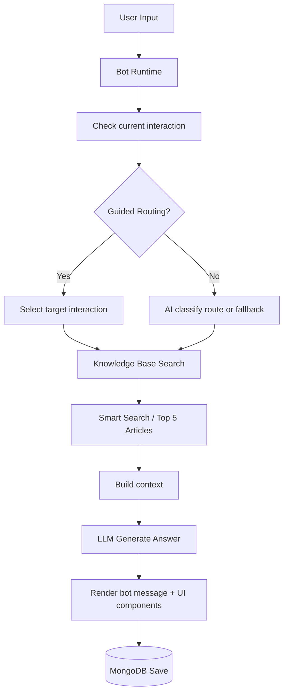

# AI Chatbot & AI Agent Platform

Dokumen ini dibuat untuk kebutuhan presentasi demo proyek. Isi README ini berfokus pada apa yang sudah ada di aplikasi, bagaimana chatbot bekerja, teknologi yang dipakai, mekanisme AI dan bot runtime, serta alur demo yang bisa ditampilkan ke audiens.

## 1. Gambaran Umum Proyek

Proyek ini adalah platform chatbot berbasis AI yang memungkinkan admin atau manager untuk:

- membuat chatbot dan alur percakapan
- mengelola Knowledge Base
- mengatur prompt dan konfigurasi AI
- memilih provider LLM
- menguji chatbot secara langsung dari dashboard
- memonitor riwayat percakapan
- membuat bot dengan flow yang terstruktur, bukan sekadar chat satu arah

Aplikasi ini bukan hanya chatbot casual. Ini adalah sistem AI agent-like dengan kombinasi:

- flow percakapan terstruktur
- routing berbasis interaction
- Knowledge Base sebagai sumber informasi
- retrieval untuk mengambil konteks yang relevan
- model LLM untuk menghasilkan jawaban natural
- reusable components seperti tombol, card, dan carousel untuk pengalaman interaksi yang lebih kaya

Jadi intinya: proyek ini menggabungkan antara chatbot biasa, RAG, workflow bot, dan dashboard manajemen.

---

## 2. Fitur yang Ada di Aplikasi

### 2.1 Autentikasi dan Manajemen Pengguna

Aplikasi memiliki sistem autentikasi dengan login/register dan role-based access:

- admin
- manager
- public_user

Fitur ini dipakai untuk membatasi akses ke dashboard, bot management, knowledge base, dan mode publik.

### 2.2 Dashboard Admin / Manager

Dashboard mengelola beberapa hal penting:

- total pengguna
- jumlah percakapan
- jumlah prompt
- jumlah sumber pengetahuan
- daftar knowledge base yang aktif
- statistik bot dan alur
- visual overview dari ekosistem sistem

### 2.3 Knowledge Base Management

Aplikasi menyediakan fitur untuk:

- membuat knowledge base baru
- menambahkan artikel secara manual
- import artikel dari CSV
- edit dan hapus artikel
- melihat detail artikel
- filter berdasarkan kategori
- mencari artikel dari KB yang aktif

Knowledge Base adalah sumber utama sebagai pengetahuan yang dibaca oleh chatbot.

### 2.4 Bot Builder / Flow Manager

Fitur utama aplikasi adalah bot builder. Di sini admin bisa membuat alur bot seperti:

- welcome message
- guided routing
- text question
- small talk
- rag
- web search
- data collection
- skill escalation

Bot dibuat dalam bentuk interaction graph, seperti node dan edge, mirip state machine. Setiap node bisa memiliki nextAction, route, prompt, variabel, dan konfigurasi khusus.

### 2.5 Prompt Management

Aplikasi juga punya manajemen prompt yang dipakai untuk:

- guided routing
- rag
- small talk

Prompt bisa diatur per interaction, sehingga setiap bot bisa punya gaya respons yang berbeda.

### 2.6 Chatbot Experience

Chatbot memungkinkan:

- percakapan langsung dengan user
- pilihan tombol quick reply
- pertanyaan bebas
- jawaban berdasarkan data internal Knowledge Base
- menampilkan komponen UI seperti tombol, card, carousel
- menampilkan sumber artikel yang relevan
- melanjutkan percakapan dengan state yang tersimpan

### 2.7 AI Provider Configuration

Proyek mendukung dua mode AI utama:

- LM Studio (local model / lokal)
- OpenRouter (cloud / API access)

Ini sangat penting karena aplikasi bisa dipakai dengan model lokal maupun model publik tanpa harus menulis custom model sendiri.

---

## 3. Chatbotnya Itu Apa Sebenarnya?

Chatbot dalam aplikasi ini bukan chatbot "asal jawab" yang berdiri sendiri tanpa konteks. Ia adalah chatbot yang dibangun dengan arsitektur hybrid:

- deterministic flow: bot mengikuti alur yang sudah ditentukan
- generative AI: model menghasilkan jawaban natural
- retrieval-based knowledge: bot mencari informasi dari Knowledge Base sebelum menjawab

Jadi chatbot ini berfungsi seperti AI assistant yang:

1. memahami intension user
2. memilih interaction yang tepat
3. mencari sumber data yang relevan
4. mengirim konteks ke LLM
5. menghasilkan jawaban berbasis data
6. menampilkan komponen interaksi tambahan bila perlu

Dengan kata lain, bot ini bukan sekadar chat model saja. Ia adalah sistem AI agent yang dibentuk dari flow + retrieval + generation + UI.

---

## 4. Teknologi yang Dipakai

| Bagian | Teknologi |
|---|---|
| Frontend | Next.js 16, React 19, TypeScript |
| Styling | Tailwind CSS 4 |
| Backend API | Next.js App Router API Routes |
| Database | MongoDB |
| Auth | JWT + cookie + bcryptjs |
| Flow Editor | React Flow / @xyflow/react |
| AI Provider | LM Studio dan OpenRouter |
| CSV Import | Papa Parse |
| UI Icons | Lucide React |

### LLM yang dipakai

Aplikasi ini tidak melatih model sendiri. Ia memanfaatkan provider AI yang sudah ada:

- LM Studio untuk model lokal
- OpenRouter untuk model cloud

Model yang dipilih bisa berupa model gratis atau model lokal yang kompatibel dengan OpenAI-like API.

Contoh model yang terdaftar di kode adalah:

- openrouter/free
- Llama 3.3 70B Instruct
- Llama 3.1 8B Instruct
- Gemini 2.0 Flash
- Gemma 3
- Phi-4
- Mistral 7B
- Qwen3
- DeepSeek R1

Secara teknis, aplikasi memanggil endpoint chat/completions yang kompatibel OpenAI, baik ke LM Studio maupun OpenRouter.

---

## 5. Cara Kerja Chatbot / Mekanisme Sistem

### 5.1 User membuka chat

Saat user masuk ke halaman chatbot, sistem akan mengambil skill/bot yang relevan lalu membuat conversation baru jika belum ada.

### 5.2 Bot memulai dengan welcome interaction

Bot bisa mulai dengan:

- welcome message
- quick reply
- text question
- route pilihan

Welcome interaction bisa menampilkan teks dinamis seperti nama user, tanggal, role, dll.

### 5.3 Guided Routing

Ketika user mengirim pesan, bot mengecek interaction type yang aktif. Jika bot punya guided_routing, sistem akan melihat apakah input cocok dengan route yang sudah didefinisikan.

Jika cocok, bot akan mengarahkan ke interaction tertentu. Jika tidak cocok, sistem bisa memanggil LLM untuk mengklasifikasikan intent user ke route yang valid.

### 5.4 Retrieval (RAG)

Untuk pertanyaan yang butuh data, program menjalankan retrieval dari Knowledge Base.

Prosesnya:

1. query dibersihkan dari tanda baca dan stopwords
2. query di-tokenisasi
3. kata kunci dibandingkan dengan field artikel, seperti:
   - title
   - category
   - summary
   - detail
   - content
   - tags
   - field tambahan lain
4. tiap artikel diberi skor relevansi
5. artikel diurutkan dari skor tertinggi
6. diambil maksimal 5 artikel paling relevan

Ini adalah Smart Search. Artinya retrieval tidak menggunakan embedding atau vector database, tetapi teknik scoring berbasis keyword dan relevansi textual.

### 5.5 Context dikirim ke LLM

Setelah retrieval, sistem membuat "knowledge context" dari artikel yang relevan. Context itu lalu dikirim bersama pertanyaan user ke model AI.

LLM kemudian menjawab berdasarkan konteks tersebut, bukan hanya dari memorinya sendiri.

### 5.6 Jawaban dikeluarkan dan disimpan

Jawaban hasil AI disimpan ke conversation. Selain itu, sistem juga menyimpan:

- top articles
- matched keywords
- generation duration
- metadata interaction
- component UI yang relevan

---

## 6. Apa yang Dipakai untuk Membuat Bot?

Pada proyek ini, bot dibuat dari kombinasi beberapa komponen utama:

### 6.1 Bot Definition

Bot disimpan dalam MongoDB sebagai definisi yang berisi:

- nama bot
- deskripsi
- entryInteractionId
- daftar interactions
- custom variables
- transisi antar node

### 6.2 Bot Interactions

Setiap bot terdiri dari interaction-node. Contoh interaction yang ada:

- welcome_message
- guided_routing
- rag
- small_talk
- web_search
- data_collection
- data_collection_submitted
- skill_escalation
- text_question

Setiap interaction punya:

- id
- type
- position
- config
- nextAction

### 6.3 Guided Route

Guided Routing digunakan untuk mengarahkan user ke jalur tertentu. Contoh:

- profil
- pendidikan
- pengalaman
- proyek
- skill
- organisasi

Setiap route punya:

- label
- variable
- prompt
- target interaction

### 6.4 Data Collection

Data collection adalah fitur untuk mengumpulkan data bertahap dari user. Bot menanyakan pertanyaan satu per satu, lalu menyimpan jawaban pada state conversation.

Contoh penggunaan:

- onboarding user
- form pengumpulan kebutuhan
- survey
- lead capture

### 6.5 Prompt dan System Instruction

Prompt sangat penting untuk memengaruhi kualitas jawaban. Aplikasi menyimpan prompt berdasarkan tipe interaction, misalnya:

- routing prompt
- rag prompt
- small talk prompt

Prompt bisa dikustomisasi supaya bot lebih fokus dan konsisten.

### 6.6 Knowledge Base

Knowledge Base adalah sumber informasi yang dipakai bot saat menjawab. Semakin bagus kualitas data di KB, semakin bagus jawaban AI.

### 6.7 Reusable Components

Bot bisa menampilkan komponen UI seperti:

- Reply Buttons
- Link Buttons
- Cards
- Carousel

Komponen ini bisa terkait dengan artikel tertentu di KB, jadi saat artikel paling relevan ditemukan, component yang relevan bisa muncul bersamaan dengan jawaban.

---

## 7. Bot Runtime dan Arsitektur Eksekusi

Bot runtime ada pada file `src/lib/bot-runtime.ts`.

Runtime ini bertanggung jawab untuk:

- memproses pesan user
- membaca state bot
- menentukan interaction yang sedang aktif
- memutar flow sesuai nextAction
- memanggil AI
- menjalankan search
- memilih artikel paling relevan
- menggabungkan prompt + context
- menghasilkan jawaban assistant
- menampilkan component terkait
- menyimpan hasil ke database

Runtime juga menangani:

- message formatting
- variable replacement pada prompt
- custom variable dari bot
- history conversation
- AI config yang dipilih sesuai provider

### Flow runtime sederhana

---

## 8. Cara Bot Membaca Data dan Menyusun Jawaban

Data yang dibaca bot biasanya berasal dari:

- Knowledge Base collection
- bot definition
- interaction config
- prompt template
- session variables
- conversation history

### Proses membaca data

1. user mengirim pertanyaan
2. bot mengecek interaction tujuan
3. system mengambil Knowledge Base yang dipilih pada interaction
4. smart search mengurutkan artikel berdasarkan relevansi
5. sistem mengambil top 5 artikel
6. context dibuat dan dijadikan bahan untuk model
7. model merangkum jawaban dari informasi tersebut

### Kenapa perlu retrieval?

Karena model tidak bisa mengingat semua data internal organisasi secara akurat. Retrieval membantu model fokus pada fakta yang memang relevan dengan pertanyaan user.

### Batasan

Aplikasi ini belum memakai vector search atau embedding-based semantic retrieval. Saat ini retrieval masih berbasis:

- normalisasi text
- tokenisasi
- stopword removal
- matching keyword
- scoring berdasarkan bobot relevansi

Artinya hasilnya sangat bergantung pada kata kunci yang ada di data dan kualitas isi artikel.

---

## 9. Cara Bot Memberi Suggestion Component

Fitur ini sangat menarik karena bot tidak hanya menjawab teks, tetapi juga menampilkan komponen interaktif.

### Mekanismenya

- Saat retrieval menemukan artikel paling relevan, sistem memeriksa apakah artikel punya referensi component
- Jika ada, runtime akan mencari reusable component yang terhubung ke artikel tersebut
- Component yang sesuai lalu ditampilkan di chat bersama jawaban assistant

Jenis component yang didukung:

- Reply Button
- Link Button
- Card
- Carousel

Contoh:

- artikel tentang pengalaman kerja -> muncul card pengalaman
- artikel tentang proyek -> muncul carousel proyek
- artikel tentang skill -> muncul quick reply untuk topik lanjutan

Jadi komponen bukan muncul sembarangan. Ia dipicu oleh konteks artikel yang paling relevan.

---

## 10. Tools dan Interaction yang Ada di Sistem

### 10.1 Tool / Interaction Type

- Welcome Message: sapaan dan menu awal
- Guided Routing: menyambungkan user ke node yang tepat
- Small Talk: chat non-faktual / percakapan ringan
- RAG: pencarian + jawaban berbasis Knowledge Base
- Web Search: cari informasi di web
- Data Collection: kumpulkan data user bertahap
- Data Collection Submitted: proses validasi dan simpan hasil
- Skill Escalation: alihkan ke bot/skill lain atau human assistance
- Text Question: pertanyaan langsung yang masuk ke flow

### 10.2 Tools bagi Admin

Dalam dashboard, admin memiliki tools seperti:

- Bot Flow Editor
- Knowledge Base Management
- Prompt Configuration
- AI Provider Setting
- Conversation Monitoring
- User & Role Management

Ini membuat aplikasi terlihat seperti platform AI agent builder, bukan hanya aplikasi chatbot biasa.

---

## 11. Data Flow Secara Umum

Data dalam aplikasi bergerak seperti ini:

1. User login dan masuk ke dashboard/chatbot
2. User memilih bot/skill
3. Bot runtime membaca conversation dan state
4. Input user diproses oleh routing/fallback
5. Retrieval mengambil artikel dari KB
6. Context dikirim ke model AI
7. Model membangun jawaban
8. UI menampilkan jawaban + component yang relevan
9. Semua data disimpan ke MongoDB

---

## 12. Demo Presentasi yang Cocok

### Versi Singkat (untuk pitch 2-3 menit)

> “Proyek ini adalah AI chatbot platform yang menggabungkan bot flow, Knowledge Base, dan LLM dalam satu sistem. Admin bisa membuat alur chatbot, mengelola pengetahuan, mengatur prompt, dan memilih provider AI. Saat user bertanya, sistem pertama-tama memilih route yang tepat, mengambil artikel relevan dari Knowledge Base, lalu mengirim konteks tersebut ke model LLM untuk menghasilkan jawaban yang lebih akurat. Bot juga bisa menampilkan komponen interaktif seperti tombol, card, dan carousel sesuai konteks jawaban. Teknologi yang dipakai adalah Next.js, MongoDB, LM Studio/OpenRouter, dan sistem custom bot runtime yang mengelola flow dan retrieval.”

### Versi Lengkap (untuk demo ke audiens teknis)

> “Aplikasi ini adalah AI agent platform untuk mengelola chatbot secara terstruktur. Di satu sisi, ada dashboard admin untuk membuat bot dan mengatur data; di sisi lain, ada runtime bot yang mengelola flow percakapan. Saat user bertanya, bot dapat memilih interaction route, melakukan smart search di Knowledge Base, mengambil artikel relevan, dan menyerahkan konteks ke model LLM untuk menjawab. Hasilnya bukan hanya teks, tetapi juga komponen interaktif yang tertaut ke artikel yang relevan. Proyek ini memanfaatkan Next.js, MongoDB, serta provider AI seperti LM Studio dan OpenRouter. Arsitekturnya menggabungkan flow-driven chatbot, retrieval-based generation, dan reusable UI components untuk pengalaman chatbot yang lebih informatif dan kaya interaksi.”

---

## 13. Kesimpulan

Proyek ini menunjukkan bahwa chatbot tidak harus sekadar model AI yang menjawab tanpa arah. Dengan kombinasi:

- flow builder
- content knowledge base
- prompt control
- AI provider configuration
- bot runtime
- smart retrieval
- UI components

maka chatbot bisa menjadi produk yang lebih terstruktur, lebih akurat, dan lebih siap dipakai untuk kebutuhan bisnis atau layanan digital.

Proyek ini cocok untuk demo karena menunjukkan satu hal penting: AI bukan hanya soal model, tapi juga soal bagaimana data, state, routing, retrieval, dan pengalaman pengguna dipadukan dalam satu sistem.

---

## 14. Referensi Implementasi

- src/lib/ai.ts
- src/lib/bot-runtime.ts
- src/lib/smart-search.ts
- src/lib/bot-flows.ts
- src/app/dashboard/chatbot/page.tsx
- src/app/dashboard/knowledge-base/page.tsx
- src/app/dashboard/bot-management/[id]/page.tsx
- src/app/api/conversations/[id]/messages/route.ts
- src/lib/mongodb.ts
